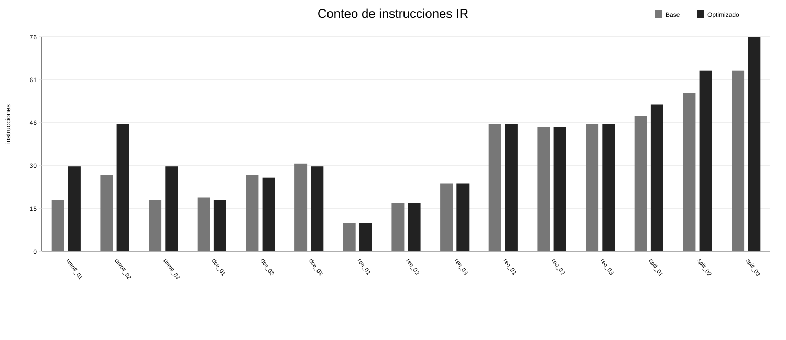
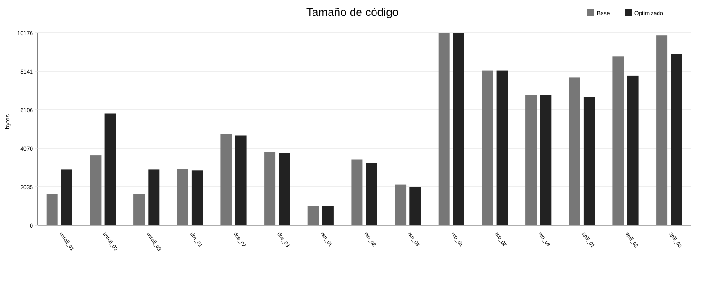
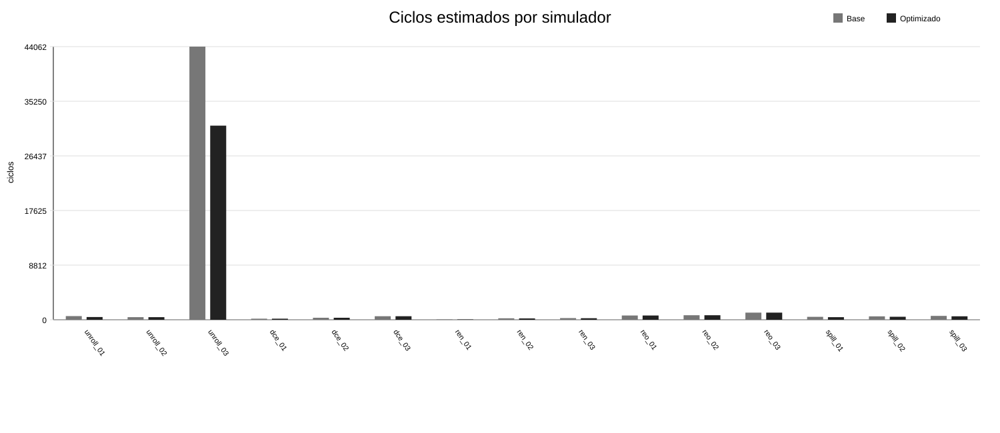
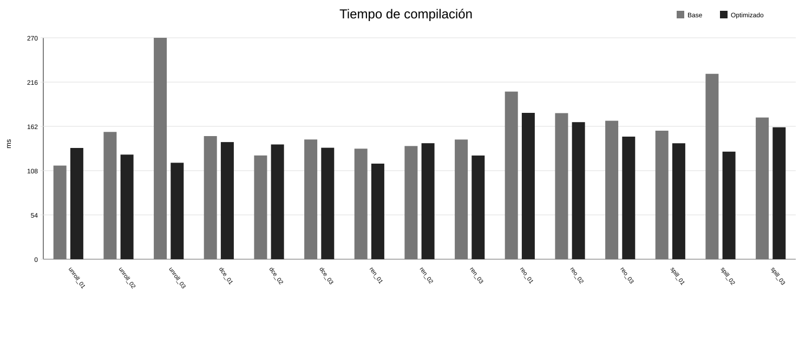
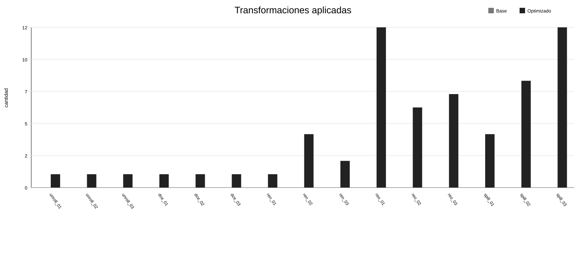

# Métricas de las 15 pruebas obligatorias

Todas las pruebas verifican el mismo resultado antes y después de la optimización y exigen RAW=0 en el simulador funcional.

| Prueba | Optimización | IR antes | IR después | Bytes antes | Bytes después | Ciclos antes | Ciclos después | Transformaciones |
|---|---|---:|---:|---:|---:|---:|---:|---:|
| unroll_01 | Loop unrolling | 18 | 30 | 1648 | 2944 | 590 | 437 | 1 |
| unroll_02 | Loop unrolling | 27 | 45 | 3696 | 5920 | 423 | 415 | 1 |
| unroll_03 | Loop unrolling | 18 | 30 | 1648 | 2944 | 44062 | 31312 | 1 |
| dce_01 | DCE | 19 | 18 | 2976 | 2896 | 171 | 171 | 1 |
| dce_02 | DCE | 27 | 26 | 4832 | 4752 | 325 | 325 | 1 |
| dce_03 | DCE | 31 | 30 | 3888 | 3808 | 569 | 569 | 1 |
| ren_01 | Renombramiento | 10 | 10 | 1008 | 1008 | 55 | 55 | 1 |
| ren_02 | Renombramiento | 17 | 17 | 3488 | 3280 | 232 | 219 | 4 |
| ren_03 | Renombramiento | 24 | 24 | 2144 | 2016 | 273 | 249 | 2 |
| reo_01 | Reordenamiento | 45 | 45 | 10176 | 10176 | 693 | 693 | 12 |
| reo_02 | Reordenamiento | 44 | 44 | 8176 | 8176 | 729 | 729 | 6 |
| reo_03 | Reordenamiento | 45 | 45 | 6896 | 6896 | 1154 | 1152 | 7 |
| spill_01 | Spilling | 48 | 52 | 7808 | 6800 | 478 | 415 | 4 |
| spill_02 | Spilling | 56 | 64 | 8928 | 7920 | 548 | 485 | 8 |
| spill_03 | Spilling | 64 | 76 | 10048 | 9040 | 618 | 555 | 12 |

## Gráficas

Para las pruebas de spilling, la línea base usa `--codegen-ir-mem`, que conserva los temporales en memoria. Esto permite medir el costo del esquema previo aun cuando el programa excede intencionalmente los nueve registros físicos x4-x12.
