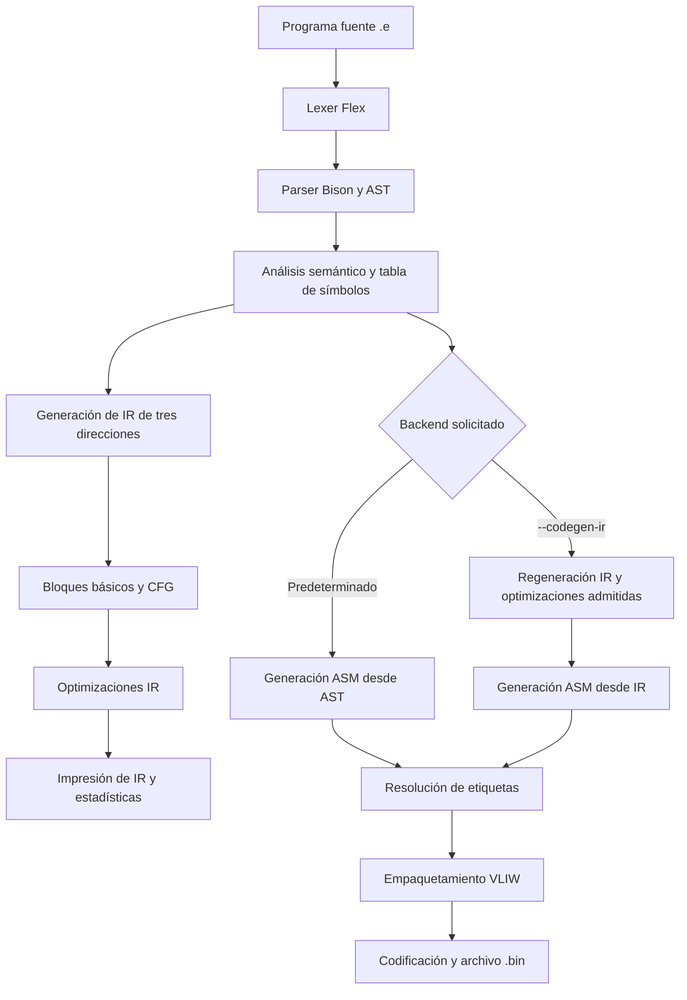
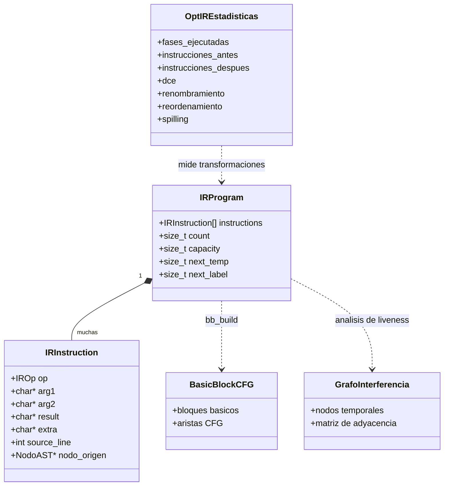
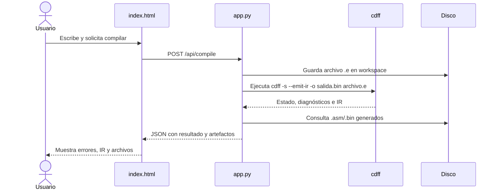
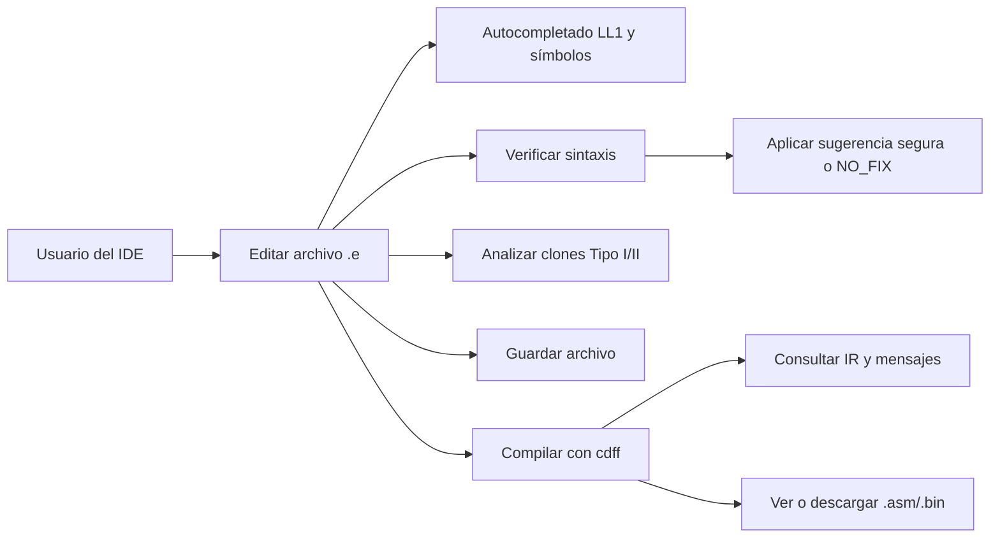

# 2. Diseño del programa y diagramas

## 2.1 Arquitectura funcional

El sistema tiene dos componentes principales: el compilador y el IDE web. El compilador usa el frontend Flex/Bison, un árbol de sintaxis abstracta (AST), análisis semántico e IR de tres direcciones. La generación final puede usar el backend tradicional desde AST o, cuando se selecciona explícitamente, el backend desde IR.

**Nota sobre el diagrama:** el recorrido `IR → OPT → VIS` y la selección de backend están separados intencionalmente. El IR utilizado para mostrar el CFG se libera y el backend IR vuelve a construirlo. Por ello, `--unroll` actualmente **no llega a la generación del `.bin`**, y el backend IR rechaza `OPT_IR_SPILL`.

## 2.2 Organización de módulos

| Componente | Archivos principales | Responsabilidad |
|---|---|---|
| Frontend y AST | `lexer.l`, `parser.y`, `ast.c` | Leer, analizar y estructurar el programa. |
| Semántica | `semantico.c`, `tabla_simbolos.c` | Validar tipos, declaraciones, funciones y ámbitos. |
| IR | `ir.c`, `ir_ast.c` | Mantener secuencia de instrucciones de tres direcciones. |
| CFG | `basic_blocks.c` | Delimitar bloques y relaciones de flujo. |
| Variables vivas | `liveness.c` | Calcular información USE/DEF e IN/OUT. |
| DCE | `dead_code_elimination.c` | Eliminar cálculos innecesarios conservando efectos relevantes. |
| Loop unrolling | `loop_unrolling.c` | Duplicar cuerpos de ciclos admitidos con factor y límites. |
| Dependencias/DAG | `dependencias.c`, `dag.c` | Modelar dependencias y regiones seguras. |
| Renombramiento | `renombramiento.c` | Cambiar nombres de temporales/definiciones admitidas. |
| Reordenamiento | `reordenamiento.c` | Reordenar operaciones respetando dependencias y barreras. |
| Spilling | `grafo_interferencia.c`, `asignacion_registros.c`, `spill_transform.c` | Detectar presión, colorear y reescribir accesos temporales. |
| Coordinador | `optimizaciones_ir.c` | Aplicar fases en orden sobre una copia del IR. |
| Backend | `codegen.c`, `codegen_ir.c`, `scheduler.c`, `vliw_packer.c`, `binario.c` | Traducir, calendarizar, empaquetar y codificar. |
| IDE | `ide/app.py`, `ide/index.html`, `ide/ide_*.c`, `ide/ll1_predict.c` | Edición, sugerencias, errores, clones y compilación. |

## 2.3 Diagrama UML de clases/estructuras principales

Las estructuras en C representan módulos de datos y APIs, no clases con herencia. Este UML simplificado muestra sus relaciones conceptuales sin atribuir métodos no existentes.

También se incluye el código fuente editable en [diagrama_clases.puml](diagramas/diagrama_clases.puml).

## 2.4 Diagrama UML de secuencia: compilación desde el IDE

[Secuencia en PlantUML](diagramas/secuencia_compilacion.puml).

## 2.5 Diagrama de funcionalidades del IDE

## 2.6 Restricciones de diseño relevantes

- En el VLIW, el empaquetamiento debe respetar cuatro slots de 32 bits (`ALU`, `LSU`, `BRU`, `FEIST`) y llenar los no utilizados con ceros.
- El hardware no realiza calendarización dinámica de dependencias entre bundles; el compilador debe producir un orden seguro e insertar NOP cuando corresponda.
- El IDE ejecuta `cdff` como proceso independiente. Su analizador LL(1) auxiliar está orientado a sugerencias/correcciones, y **no sustituye** la validación del parser Flex/Bison del compilador.
- El detector de clones opera desde el IDE y puede comparar archivos diferentes; el servidor presenta los resultados a la interfaz.
- Los detalles del hardware y sus contadores no pueden darse por comprobados a partir de los tests unitarios de IR.
